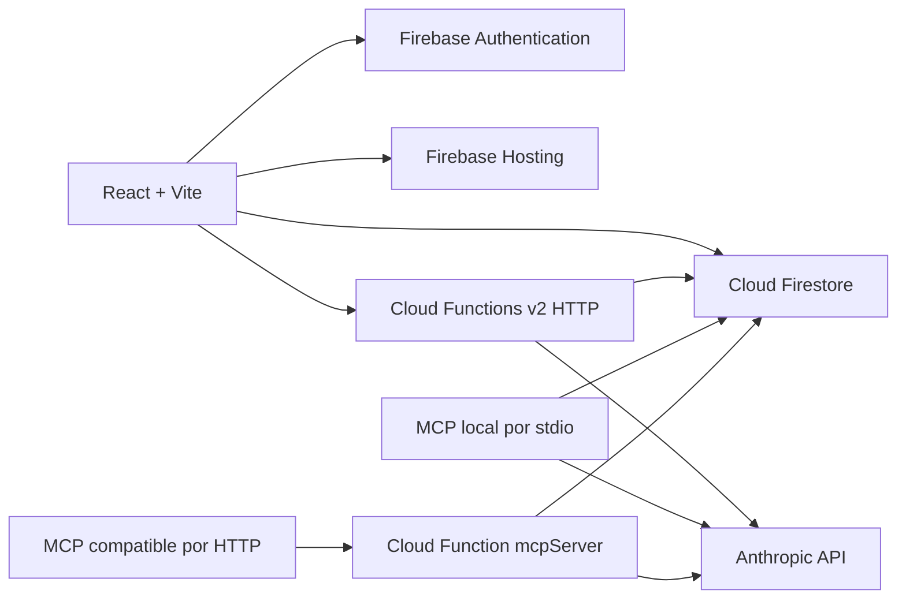

# Arquitectura de iAprende

## Resumen

El navegador autentica a las personas mediante Firebase Authentication y lee/escribe datos con el SDK web de Firestore. La aplicación organiza pantallas y vistas en `src/pages`, componentes reutilizables en `src/components` y estado/listeners en `src/store/useStore.ts`. `src/context/AuthContext.tsx` expone el usuario y su rol; `src/App.tsx` conecta rutas con vistas y guardas de rol.

Cloud Functions v2 proporciona operaciones HTTP, trabajos programados y un endpoint MCP stateless. La lógica de IA vive principalmente en `functions/src/ai/`; la inicialización de Firebase Admin está en `functions/src/firebaseAdmin.ts`. El cliente MCP stdio es un ejecutable separado en `mcp-server/src/index.ts`.

## Roles y pantallas

Los roles de la aplicación son `alumno`, `maestro` y `admin`. `RoleGuard` controla el acceso a vistas; `RoleRedirect` dirige la ruta `/` al panel correspondiente. La autenticación/rol para el acceso a los documentos debe reforzarse en las reglas de Firestore y en los endpoints del servidor; ocultar una ruta en la interfaz no constituye autorización de datos. El servidor verifica ID token con revocación y lee el rol protegido. El modelo es de una institución; el personal docente conserva acceso institucional amplio. MCP HTTP exige admin.

| Rol | Capacidades visibles principales |
|---|---|
| Alumno | Panel, cursos, lecciones, grupos, progreso y calificaciones |
| Maestro | Cursos, editor, impartición, grupos y libro de calificaciones |
| Admin | Gestión de usuarios, grupos, cursos y vistas administrativas |

Rutas completas y componentes asociados se encuentran en `src/App.tsx`.

## Contenido y estado

`src/store/useStore.ts` centraliza el acceso de la interfaz a Firestore y sus listeners. Filtra respuestas/solicitudes del alumno y notificaciones por UID, lee analytics individual y vacía el caché al salir. `StoreInitializer` inicia listeners cuando la autenticación terminó y hay una persona activa. `src/store/seedCursoIA.ts` incluye datos semilla locales para contenido de demostración. `src/types/index.ts` contiene los tipos compartidos en el frontend.

Los componentes `src/components/bloques/` renderizan tipos de contenido interactivo. Para añadir un tipo nuevo, revisa el modelo de datos y el flujo del editor/visor además del componente visual; el tipo debe poder crearse, persistirse y renderizarse para ambos roles.

## Colecciones Firestore

Las reglas actuales hacen referencia a estas colecciones:

| Colección | Uso observable en reglas/código |
|---|---|
| `usuarios` | Perfil y rol de usuario |
| `cursos` | Metadatos de cursos |
| `bloques` | Bloques de contenido |
| `grupos` | Cohortes o grupos de aprendizaje |
| `grupo_alumnos` | Inscripciones alumno-grupo |
| `respuestas` | Respuestas y calificaciones |
| `alumno_analytics` | Resultados de análisis por alumno |
| `notificaciones` | Mensajes dirigidos a usuarios |
| `progreso_alumno` | Avance por alumno/curso |
| `solicitudes_inscripcion` | Solicitudes para unirse a grupos |
| `curso_grupos` | Asignaciones de cursos a grupos |
| `caso_etico_respuestas` | Respuestas colaborativas de casos |
| `ai_usage` | Cuota HTTP por UID; solo Admin SDK |

La estructura exacta de cada documento debe contrastarse con los tipos y operaciones en `src/store/useStore.ts`, `functions/src/` y el curso desplegado. Las reglas viven en `firestore.rules`; las lecturas mediante Admin SDK en Cloud Functions no pasan por esas reglas.

## Cloud Functions

| Exportación | Módulo | Función |
|---|---|---|
| `aiProxy` | `proxy/aiProxy.ts` | Adapta solicitudes con forma OpenAI al API de Anthropic |
| `autoGradeRespuestaFn` | `ai/autoGrade.ts` | Califica una respuesta abierta con IA |
| `generateCourseFromTopicFn` | `ai/courseGenerator.ts` | Genera curso desde tema/contexto y puede persistirlo |
| `queryClassDataFn` | `ai/analyticsQuery.ts` | Contesta preguntas sobre datos de clase |
| `detectKnowledgeGapsFn` | `ai/knowledgeGaps.ts` | Detecta brechas a partir de analítica del alumno |
| `getPersonalizedLearningPathFn` | `ai/learningPath.ts` | Propone ruta adaptativa para alumno/curso |
| `translateBlockFn` | `ai/contentTranslation.ts` | Traduce o simplifica un bloque |
| `dailyDigestFn` | `scheduled/dailyDigest.ts` | Programa el digest diario a las 07:00 en `America/Mexico_City` |
| `evaluatePromptFn` | `ai/promptSimulator.ts` | Evalúa estructura del prompt (0–5) |
| `executePromptFn` | `ai/promptSimulator.ts` | Ejecuta el ejercicio y devuelve `{response}` |
| `mcpServer` | `mcp/mcpHttpFunction.ts` | Atiende el protocolo MCP por HTTP sin sesión persistente |

Los nombres de exportación son los del código fuente; los nombres de URL de Firebase pueden variar por región/proyecto. `functions/src/index.ts` define exports y opciones HTTP; `security/http.ts` centraliza identidad, validación básica, cuota persistente y errores seguros. `src/lib/http.ts` añade el token del navegador. Verifica el comportamiento y la seguridad de cada endpoint antes de considerarlo público.

## Integración MCP

`functions/src/mcp/` contiene servidor, herramientas de IA, herramientas de lectura/escritura y recursos para la Cloud Function HTTP. `mcp-server/src/index.ts` contiene un servidor stdio independiente para un cliente local. Requiere credenciales de Firebase Admin y clave Anthropic en el entorno del proceso. HTTP expone 14 herramientas y 2 recursos; stdio expone 7 herramientas y 2 recursos. Son catálogos diferentes. HTTP usa Streamable HTTP stateless con respuesta JSON; no implementa OAuth de terceros. El listado y los esquemas exactos de las herramientas están definidos en el arreglo `TOOLS` y sus handlers; revisa el código antes de conceder acceso de escritura.

## Build y alojamiento

Vite compila el frontend a `dist/`; Firebase Hosting publica esa carpeta y reescribe las rutas hacia `/index.html` para React Router. `firebase.json` también apunta las reglas a `firestore.rules` y Functions a `functions/`. El paquete Functions compila TypeScript desde `functions/src` a `functions/lib`; `mcp-server/tsconfig.json` define el build MCP.

Antes de desplegar, verifica el alias de `.firebaserc`, los secretos, las reglas, la región de Functions y las variables `VITE_*` compiladas. Las variables `VITE_*` quedan embebidas en el JavaScript público y no pueden contener secretos.
